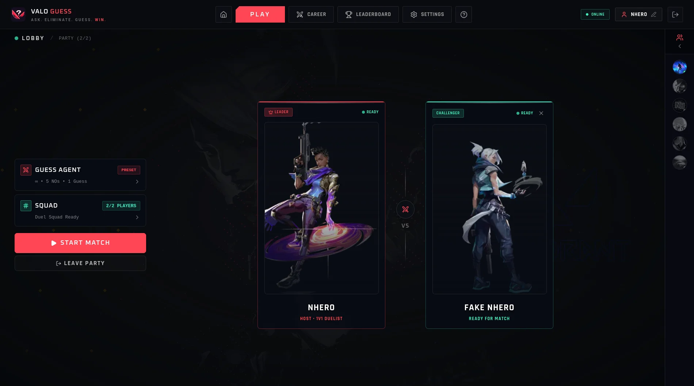
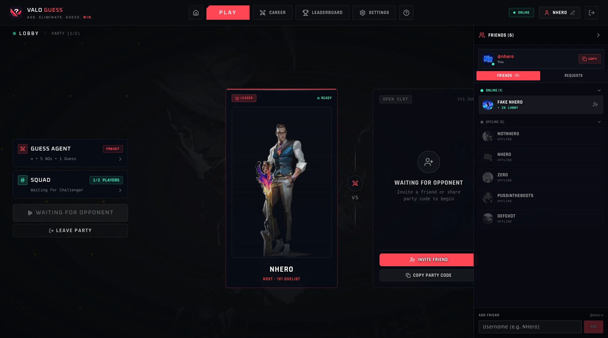
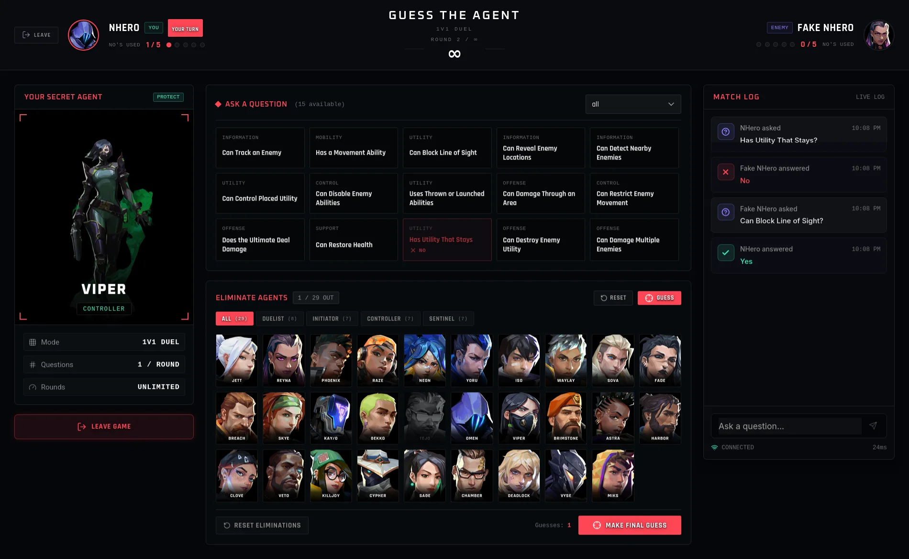
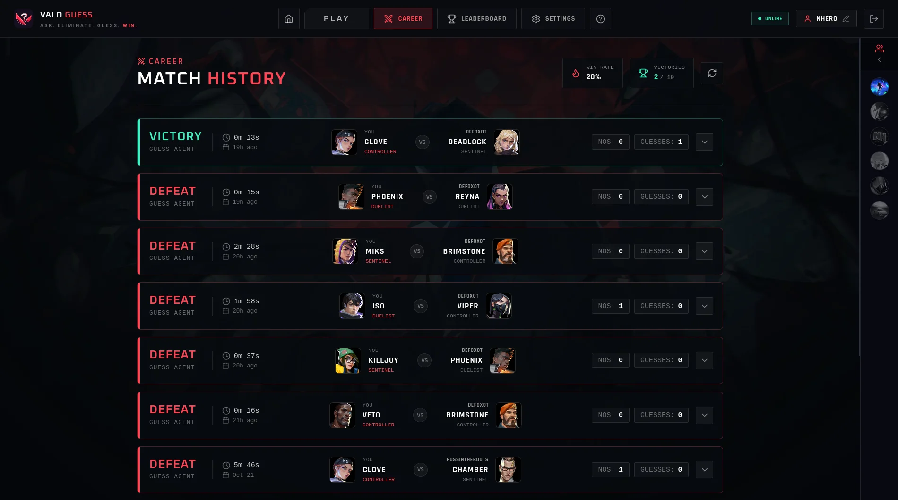

# ValoGuess Socket Server

This is the real-time server for
[ValoGuess](https://github.com/Valoguess/valoguess). It handles parties,
player presence, and live matches over Socket.IO.

The web app handles sign-in and most profile-related actions. This
server verifies the client's JWT, manages active game state, and uses
Redis for temporary data.

## How it works

The socket server verifies JWTs against the JWKS endpoint exposed by the
Next.js app. PostgreSQL stores persistent records, while Redis holds
live state such as parties, active games, presence, and rate-limit data.

## Screenshots









## Current features

-   **Parties:** create and join parties, invite friends, and use party
    chat.
-   **Friends and presence:** sync friend requests and show online
    status.
-   **Guess the Agent:** run 1v1 matches with preset or freeform
    questions, turn timers, and secret-agent handling.
-   **Reconnects:** players can reconnect within a 60-second grace
    period and restore their party or match state.
-   **Rate limiting:** Redis-backed token buckets limit incoming socket
    events.
-   **Match history:** completed matches are saved to PostgreSQL.

## Tech stack

-   Node.js, TypeScript, and Socket.IO
-   Redis with `ioredis`
-   PostgreSQL with Drizzle ORM
-   `jose` for JWT/JWKS verification
-   Zod for validation
-   `helmet` for HTTP security headers
-   pnpm, `tsdown`, and `tsx`

## Run locally

You'll need Node.js 22 or later, pnpm, Redis, PostgreSQL, and the
[ValoGuess web app](https://github.com/Valoguess/valoguess) running
locally for authentication.

Clone the repo and install dependencies:

``` bash
git clone https://github.com/Valoguess/valoguess-socket-server.git
cd valoguess-socket-server
pnpm install
```

Copy the example environment file to `.env` and fill in your own values:

``` bash
cp .env.example .env
```

A `compose.yml` is also included for redis:

``` bash
docker compose up -d
```

Start the development server:

``` bash
pnpm run dev
```

## Related repository

-   [ValoGuess web app](https://github.com/Valoguess/valoguess)

## License

[MIT](LICENSE)
